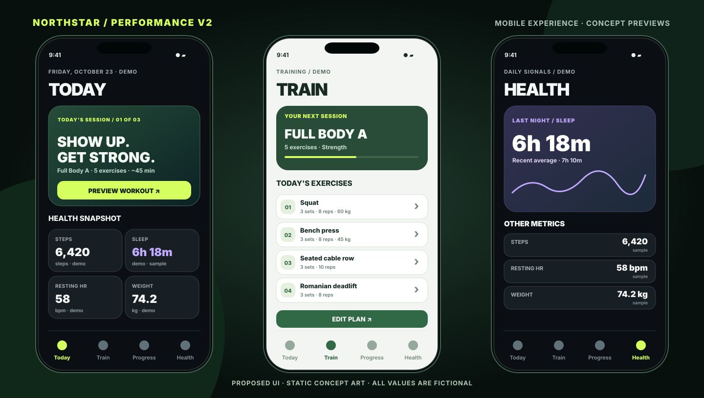
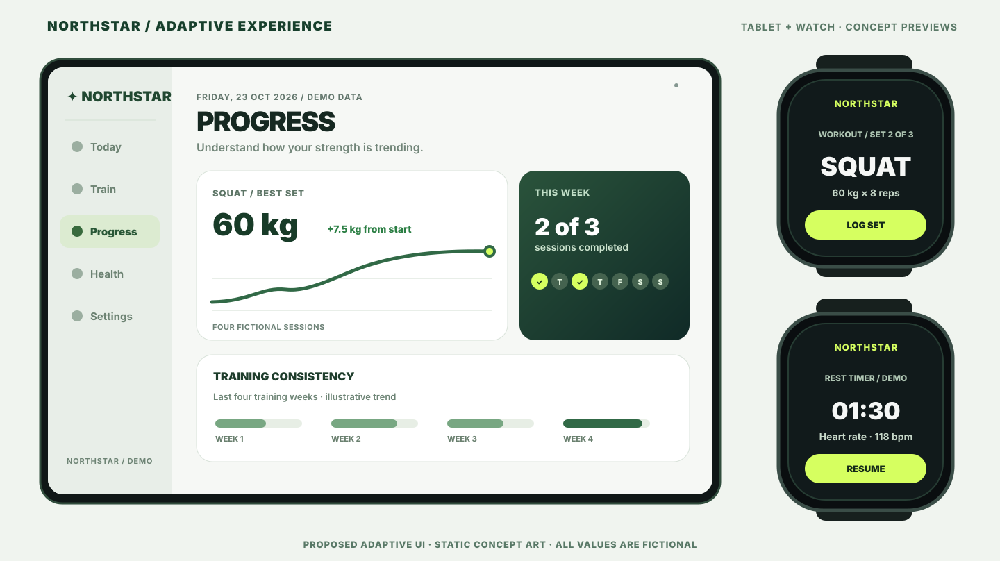

# NorthStar Health

**Train consistently. Understand your health. Keep control of your data.**

NorthStar Health is an **offline-first health and strength-training app in development** for Android, iPhone, Android tablets and iPad. It combines durable workout logging with account-bound completed-workout backup. Native Apple Watch and Wear OS companions, permission-based health metrics and a broader health dashboard are future milestones.

> **Development status — not released.** Offline workout logging and Phase 2 accounts, foreground sync and data-rights flows are merged in source. Hosted rollout, real-account security tests, device validation and large-history export support remain P2-08 release gates. HealthKit/Health Connect, Firebase collection and live watch recording are not implemented. See the [milestone tracker](docs/ROADMAP.md) and [release gates](docs/RELEASE.md). Previews below are static concepts, not application screenshots.

## UI concept previews

### Phone — Today, Train and Health



### Tablet and smartwatch — Progress, set logging and rest timer



<small>Visual references follow the existing [Performance V2 design language](docs/DESIGN_SYSTEM.md). Tablet and watch compositions are proposed extensions—not evidence of implemented features, sensor readings or tested watch runtime.</small>

## Product foundations

| Area | Decision | Delivery |
| --- | --- | --- |
| Mobile platform | Flutter, iOS / iPadOS / Android and tablet layouts | App scaffold and offline workout features implemented; device QA pending |
| State + dependency injection | Riverpod 3 | Workout, account and sync state implemented |
| Navigation | go_router, bottom tabs / adaptive side rail | Workout, progress and account routes implemented |
| On-device workout data | **ObjectBox** | Local model, repositories, exercise catalog, plan editor, live logging and history implemented |
| User identity + completed-workout sync | **Supabase Auth + PostgreSQL** | Mandatory sign-in, outbox, foreground upload/restore, tombstones and conflict review; account/sync UI, JSON export and verified deletion (#25, #27, #29) merged; hosted QA pending |
| Health measurements | **Apple HealthKit and Android Health Connect** | Permissioned read planned; no SDK permissions yet |
| Workout summary write-back | One app-owned completed workout, opt-in, no duplicates | Planned |
| Crash/usage telemetry | **Firebase Crashlytics + Analytics** | Chosen, **not installed/collecting**; explicit privacy gate |
| Watches | Native HealthKit workout service / Wear OS Health Services, watch UI under evaluation | Architecture/PoC only |

The data policy is narrow: NorthStar **owns detailed workout logs**; HealthKit and Health Connect remain the source for physiology; Supabase receives only authenticated **completed NorthStar-authored phone workouts** and essential exercise/set history, per [ADR-0005](docs/adr/0005-mandatory-auth-and-workout-sync.md). No heart-rate/HRV/sleep/SpO₂/steps sensor stream, health-platform cache, imported external workout, or location trail is backed up to Supabase. Plans/templates remain **local-only initially**: a reinstall will restore past finished sessions but not necessarily user-created plans.

## Production monorepo structure

```text
apps/
  mobile/                      # Flutter app (Android, iPhone, iPad, tablets)
    android/                   # committed native runner, generated with Flutter SDK
    ios/                       # committed iOS Runner Xcode project
    lib/                       # feature-first Dart app, Riverpod/go_router
    test/                      # Dart unit/widget tests
    pubspec.yaml               # only production Dart pub package for now
    pubspec.lock               # resolved mobile dependencies
  watch_os/                    # separate single-source SwiftUI watchOS app
    Sources/App/               # native watch entry
    Sources/Features/Workout/  # non-recording preview
    project.yml                # XcodeGen compile target; companion embedding pending
  wear_os/                     # separate native Wear OS app (Kotlin/Compose)
    app/src/main/              # watch-specific manifest/activity
    gradlew                    # Gradle wrapper
contracts/workout_sync/v1/    # language-neutral event schema + tested fixture JSON
packages/                     # Dart workspace packages when there is real reuse
supabase/                     # versioned development RPC/database migrations and pgTAP tests
experiments/                  # isolated Flutter-on-watch spikes; not in release
prototypes/performance-v2/     # preserved original HTML/CSS/JS clickable reference
docs/                         # ADRs, security, design, cloud sync, watch and release
.github/workflows/            # mobile, Wear and protocol quality gates
AGENTS.md                     # repository-wide AI coding and review instructions
```

**Not a released health product:** workout logging, mandatory sign-in, foreground backup/restore and account/data-rights flows are present in source, but the hosted backend is development-only and P2-08 release verification is pending. HealthKit, Health Connect, Firebase and live watch recording are not implemented. The native watch starter screens do not yet constitute signed/embedded watch companions.

Read [monorepo boundaries](docs/REPOSITORY_LAYOUT.md), [ADR-0004](docs/adr/0004-production-monorepo.md), [watchOS setup](apps/watch_os/README.md), [Wear OS setup](apps/wear_os/README.md), and the [watch sync contract](contracts/workout_sync/v1/README.md). Also see [AGENTS.md](AGENTS.md), [ADR-0003](docs/adr/0003-data-cloud-health.md) and the [independent review checklist](docs/REVIEW_GUIDE.md).

## Accounts, backups and data rights (development)

First use requires online email-code sign-in; subsequent workouts can be logged offline under the **same verified account**. Finishing a NorthStar-authored phone workout queues its supported session/exercise/set data for **foreground** Supabase backup; manual sync and review controls are on the Account screen. Sync status is device-local evidence, **not a guarantee** that every cloud write succeeded. Unfinished sessions, user-created plans, device settings and HealthKit/Health Connect measurements are **not backed up**. Signing out locks the old account's files rather than transferring them.

Account provides an authenticated **JSON export of completed cloud history** using the platform document picker. It currently refuses output above a provisional **4 MiB** and requires low-memory, large-history and native picker verification before release. Permanent account deletion requires fresh same-owner OTP verification and a server-side Auth hard deletion; a confirmed result removes that account's cloud data and its original device partition. On an **uncertain response**, no local files are erased automatically: users may recover the original account, **use another account while keeping old data locked**, or **explicitly erase only the old account's local data and leave**. Neither exit transfers data. Server deployment and end-to-end deletion security checks remain outstanding. See [data rights](docs/implementation/phase-2/p2-07-account-status-data-rights.md), [ADR-0007](docs/adr/0007-account-deletion-recovery-exit-choices.md), and [cloud sync](docs/CLOUD_SYNC.md).

## Codemagic CI/CD (planned)

The repository-root [`codemagic.yaml`](codemagic.yaml) contains **11 manual-only templates** for Flutter Android/iOS, native Wear OS/watchOS and quality checks, including debug, profile, simulator, Ad Hoc and release variants. **They are placeholders, not functioning build or publishing pipelines**; each intentionally fails if manually launched before configuration. Read [Codemagic setup and rollout](docs/CODEMAGIC.md) before activating any builds. Existing GitHub Actions checks remain active until equivalent Codemagic jobs are tested.

## Flutter local setup

CI uses Flutter **3.47.7 stable** and runs from **`apps/mobile`**, not repository root. Native platform runners and `pubspec.lock` belong under `apps/mobile/` and must be committed after generation, audited for package IDs/platform deployment requirements and compiled on devices.

```sh
cd apps/mobile
flutter pub get
dart format --output=none --set-exit-if-changed lib test
flutter analyze
flutter test  # Native ObjectBox host library required for store-backed tests
```

For macOS host-native tests, use `bash scripts/test_objectbox_macos.sh` from the repository root; see [contributor setup](CONTRIBUTING.md) and [ObjectBox testing](docs/OBJECTBOX.md).

**Running the app needs a Supabase backend** because sign-in is mandatory. Create your own free project and follow [Run NorthStar against your own Supabase project](docs/CONTRIBUTOR_SUPABASE_SETUP.md), then run `flutter run --dart-define-from-file=supabase.local.json`.

To build the Wear OS app, follow [apps/wear_os/README.md](apps/wear_os/README.md). To generate and inspect the watchOS target on macOS, follow [apps/watch_os/README.md](apps/watch_os/README.md). Both target official native SDKs; experiment with Flutter watch rendering under `experiments/` separately. Never assume a watch app is distributed simply because source code exists in the monorepo.

ObjectBox code generation must continue in **`apps/mobile`** when first entities exist: `dart run build_runner build --delete-conflicting-outputs`; commit `apps/mobile/lib/objectbox.g.dart` with `apps/mobile/lib/objectbox-model.json`.

## Explore the current HTML prototype

```sh
cd prototypes/performance-v2
python3 -m http.server 4173
```

Visit http://localhost:4173 for the original interactive mobile-only concept (Today, Train, Progress, Health, workout simulation, onboarding and appearance switching). Its fake data/actions are **not** integrations.

## Trust, safety and future delivery

Workouts must save locally before confirming success. Supabase updates require account ownership, server-enforced revision checks, idempotent operations and deletion semantics. Watch log delivery requires **two distinct acknowledgments**: durable phone receipt and separately confirmed cloud backup. Apple Watch `HKWorkout` written on-watch must not be duplicated by the phone. Firebase must remain off until consent and sanitization controls are reviewed. Phone/tablet access, low-end-device performance and physical-watch background reliability are release gates.

## Contributing

Contributions are welcome. Start with [CONTRIBUTING.md](CONTRIBUTING.md): it explains what's in scope, how to run the app against [your own Supabase project](docs/CONTRIBUTOR_SUPABASE_SETUP.md), the checks your PR must pass, and the rules for AI-assisted contributions.

## License

NorthStar is licensed under the [Mozilla Public License 2.0](LICENSE). You may use, modify and distribute it, including in larger proprietary works, but modified versions of NorthStar's own files must remain available under MPL-2.0. Contributions are accepted under the same license.

See [Phase 1 implementation notes](docs/implementation/README.md) for the
repository's current offline feature scope, tests and deferred QA.
